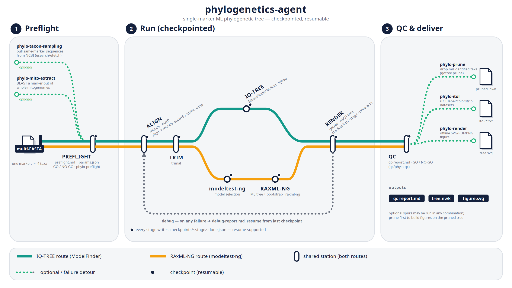

# Phylogenetics Agent

[](#-installation)
[](#-installation)
[](https://github.com/cheahhl814/bioinfo-skill-creator)

[](#-pipeline-overview)

Agentic single-marker maximum-likelihood phylogenetic tree pipeline (align -> trim -> model-select -> tree -> render), inspired by the MLTree Nextflow pipeline, rebuilt as a checkpointed BettaMt-pattern skill with per-stage preflight, resumable checkpoints, and stage-swap flexibility (muscle/mafft aligner, raxml-ng/iqtree tree tool).

**Repository**: https://github.com/cheahhl814/phylogenetics-agent

> [!NOTE]
> Current version: **v1.1.1** (updated 2026-11-16).

## Contents

- [Installation](#-installation)
- [Usage](#-usage)
- [Pipeline overview](#-pipeline-overview)
- [Tools](#-tools)
- [Update check](#-update-check)
- [Repository layout](#-repository-layout)
- [Hard guarantees](#-hard-guarantees)
- [Provenance](#-provenance)

## 🚀 Installation

This is an **agent skill**, not a user-facing library. The recommended install path is to let your AI agent import it.

**Option A — give your agent this prompt (recommended):**

```text
Install the phylogenetics-agent skill from
https://github.com/cheahhl814/phylogenetics-agent —
clone it into your agent's skills directory (the path your agent watches
for skills) and run `pixi install` from that directory. Then read the
skill's SKILL.md to understand its phases and the Input/Output contract
for each. Confirm when the environment is ready.
```

**Option B — manual install:**

```bash
git clone https://github.com/cheahhl814/phylogenetics-agent.git
cd phylogenetics-agent
pixi install
```

> [!TIP]
> `pixi install` resolves every tool from `pixi.toml` (channels: conda-forge, bioconda) into an isolated `.pixi/` environment — no system-wide installs, no version conflicts with other skills.

## 💡 Usage

The skill is designed to be driven by an AI agent: the agent reads the master `SKILL.md`, detects the current phase from the filesystem state of your run directory, and routes to the right sub-skill.

### Natural-language prompts that trigger the skill

```text
phylogenetic tree
ML tree
maximum likelihood tree
raxml
iqtree
```

### Manual phase execution

If you prefer to drive the phases yourself (or want to re-run a single phase):

```bash
# Set your run directory (all phase artifacts land here)
RUN_DIR=/path/to/run-dir

pixi run preflight   # Phase 1 — validate inputs, write preflight.md + params.json
pixi run run         # Phase 2 — execute the workflow (after preflight ≥ GO)
pixi run qc          # Phase 3 — build the final report (after run completes)
pixi run debug       # On failure — interpret stderr via the signature library
pixi run battle-test # Verify the skill's structural integrity
```

> [!IMPORTANT]
> Each phase has an explicit **Inputs/Outputs contract** at the top of its sub-skill `SKILL.md`. If the upstream artifact is missing (e.g. you run `run` before `preflight` passed), the sub-skill refuses to proceed and tells you which phase to run first. Phases are gated on purpose — don't skip them.

## 🔬 Pipeline overview

The analysis follows a phased evidence chain. Each phase consumes the artifacts of the previous phase and gates progression with a Go/No-Go check.



| # | Phase | Goal | Sub-skill | Artifact produced |
|:--|:------|:-----|:----------|:------------------|
| **1** | **Preflight** | Validate inputs; write `params.json` + verdict | `preflight/phylo-preflight` | `$RUN_DIR/preflight.md`, `$RUN_DIR/params.json` |
| **2** | **Run** | Stage-checkpointed align → trim → model_select → tree → render | `build/phylo-builder` | `$RUN_DIR/checkpoints/*.done.json` + final tree |
| **3** | **QC** | Final report + Go/No-Go verdict | `qc/phylo-qc` | `$RUN_DIR/qc-report.md` |
| **4** | **Debug** | Interpret stderr from a failed stage | `debug/phylo-debug` | `$RUN_DIR/debug-report.md` |
| **5** | **Battle-test** | Structural quality gate for the skill itself | `battle-test/phylo-battle-test` | `battle-test-report.md` |

Optional, user-triggered stages around the main chain: `preflight/phylo-taxon-sampling` and `preflight/phylo-mito-extract` (source/extend input sequences before Preflight), and `prune/phylo-prune`, `visualize/phylo-itol`, `visualize/phylo-render` (after QC).

> [!TIP]
> Read each sub-skill's `SKILL.md` for the full procedure, its ask-user stop points, and its signature library (stderr pattern → cause → fix).

## 🧰 Tools

All tools are resolved from conda-forge/bioconda via `pixi.toml`.

| Tool | Version | Role |
|:-----|:--------|:-----|
| `muscle` | * | aligner (default) |
| `mafft` | * | aligner (alternative) |
| `trimal` | * | alignment trimming |
| `modeltest-ng` | * | substitution model selection (raxml branch) |
| `raxml-ng` | * | tree inference (default) |
| `iqtree` | * | tree inference (alternative, built-in ModelFinder) |
| `gotree` | * | tree manipulation (prune) + ASCII rendering |
| `toytree` | * | offline SVG/PDF/PNG tree figures |
| `entrez-direct` | * | esearch/efetch for NCBI sequence retrieval (taxon sampling) |
| `vsearch` | * | `--cluster_fast` redundancy collapse (≥99.9%) in taxon sampling |
| `blast` | * | blastn/makeblastdb for mitogenome marker extraction |
| `packaging` | * | version parsing for toyplot PNG export |

Tool usage is grounded in the offline `docs-corpus/` snapshots (version-matched `--help`/`man` captures, upstream repo docs, and web docs as fallback) — the agent reads these instead of guessing flags.

## 🔄 Update check

Every skill built with [skill-forge](https://github.com/cheahhl814/bioinfo-skill-creator) ships a self-update check that compares the deployed git SHA against this upstream repo via `git fetch` — no GitHub API call, no extra dependencies.

```bash
pixi run update-check
```

| Verdict | Exit | Meaning |
|:--------|:-----|:--------|
| `UP-TO-DATE` | 0 | Local HEAD matches origin/HEAD |
| `LOCAL-AHEAD` | 0 | Unpushed local commits; no action needed |
| `BEHIND-BY-N` | 1 | Upstream is N commits ahead → re-pull/re-sync from this repo |
| `OFFLINE` | 2 | `git fetch` failed; informational only |
| `NO-ORIGIN` | 2 | No `origin` remote configured; informational only |

## 📁 Repository layout

```text
phylogenetics-agent/
├── SKILL.md                 # Master orchestrator (router — start here)
├── README.md                # This file
├── pixi.toml                # Pinned tool environment (pixi install)
├── params.json              # Build provenance (tracked; tool inventory, verdict)
├── docs-corpus/             # Offline snapshots of upstream tool docs
│   └── muscle/ mafft/ trimal/ modeltest-ng/ raxml-ng/ iqtree/   # core pipeline
│   └── gotree/ toytree/     # tree manipulation / rendering
│   └── entrez-direct/ vsearch/ blast/   # taxon-sampling + marker extraction
├── preflight/               # Preflight phase sub-skills
│   ├── phylo-preflight/     # Input validation + Go/No-Go gate
│   ├── phylo-taxon-sampling/   # Optional: expand FASTA with same-marker sequences from NCBI
│   └── phylo-mito-extract/  # Optional: cut a marker out of whole mitogenomes
├── build/
│   └── phylo-builder/       # Stage-checkpointed runner (align→trim→model_select→tree→render)
├── docs/
│   ├── metro-map.svg            # Workflow metro map (source, hand-authored SVG)
│   └── metro-map.png            # Raster export used by the README
├── qc/                      # Final report + verdict
├── debug/                   # Failure interpretation (signature library)
├── prune/                   # Optional: prune the tree to a curated taxon subset
├── visualize/
│   ├── phylo-itol/          # Optional: iTOL annotation datasets (labels/colorstrip)
│   └── phylo-render/        # Optional: offline SVG/PDF/PNG tree figure
├── battle-test/             # Structural quality gate for the skill itself
├── evals/                   # Trigger/eval scaffold (TODO-seeded, for skill-ab)
├── test-data/               # Deterministic fixture generator (fixtures not committed)
├── bin/
│   └── skill-update-check.py  # Self-update check (pixi run update-check)
└── pixi.lock                # Local-only convenience lock (untracked by .gitignore)
```

## 🔒 Hard guarantees

- **Filesystem evidence chain** — every phase emits the artifact the next phase consumes; the boundary between phases is the filesystem, not agent memory.
- **Docs-grounded tool usage** — tool flags come from `docs-corpus/`, never from the agent's memory.
- **Explicit stop points** — ambiguous decisions are surfaced to you as *Evidence + Recommend + Options*, not auto-picked.
- **Isolated environments** — every tool is resolved via `pixi.toml` (conda-forge/bioconda) into an isolated `.pixi/` environment.

## 🚀 Nextflow runner

This skill does not currently ship a Nextflow runner. For cohort/HPC execution, wrap the `pixi run` tasks in a workflow scheduler of your choice.

## Provenance

Built with the [skill-forge](https://github.com/cheahhl814/bioinfo-skill-creator) meta-skill (formerly bioinfo-skill-creator), following the AiX-BIO skill convention (preflight → build → debug → battle-test evidence chain). Pattern adopted from:

- **BettaMt-agents** — https://github.com/cheahhl814/BettaMt-agents
- **bacterial-genome-analysis** — https://github.com/cheahhl814/bacterial-genome-analysis
- **amr-gene-screening** — https://github.com/cheahhl814/amr-gene-screening

## License

Released under the MIT License — see the license file in this repository for details.